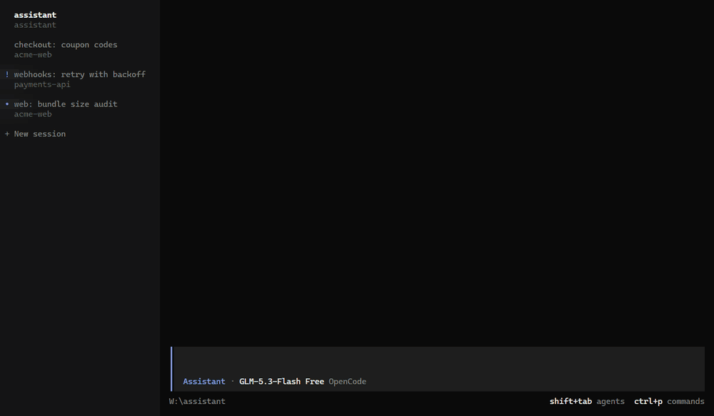

# opencode-sessions

A plugin for [OpenCode](https://opencode.ai) V2 that lets any session hand work to your other sessions and hear
back. Every top-level session gets tools to list, search, read, start, prompt, watch, open and close other
sessions. When a session finishes the work you gave it, only the session that asked is notified.

> Supports OpenCode V2 2.2.5 or newer. V1 is not supported.

<p align="center">
  
</p>

The demo shows one session handing work to a new session in another repository, the report it gets when that
session finishes, and `/go` jumping to the reporting session.

## Features

- **Answers "how are we doing with X?"** from the recent conversations of your other sessions.
- **Hands work out.** A session sends a prompt to an existing session or starts a new one, then returns at once. It
  never waits or polls.
- **Reports back to the sender only.** If session X hands work to session Y, reports from Y go to X and nowhere else.
  Each report is a row you can click to open Y, and it starts a new turn in X so X can continue.
- **Manages tabs.** New sessions open as tabs, existing ones can be reopened, and a tab can be closed once you say
  the thread is done.
- **Links sessions.** Session IDs in fenced ```` ```session ```` blocks render as clickable links.

The tools never answer permissions or questions on your behalf.

## Requirements

- OpenCode V2 2.2.5 or newer.

## Install

Install the plugin from GitHub with the OpenCode CLI. Pin a release tag: it keeps the install cache stable and lets
OpenCode check for updates.

```sh
opencode plugin add github:igorovh/opencode-sessions#v0.3.1
```

This adds the plugin to the global `plugins` array in `~/.config/opencode/opencode.jsonc`. One entry loads both
parts: the server part (the tools and the reports) and the TUI part (tabs, session links and `/go`). Restart
OpenCode afterwards.

You can also add the entry to the config yourself:

```jsonc
{
  "$schema": "https://opencode.ai/config.json",
  "plugins": ["github:igorovh/opencode-sessions#v0.3.1"]
}
```

Update or remove it later:

```sh
opencode plugin update github:igorovh/opencode-sessions
opencode plugin remove github:igorovh/opencode-sessions
```

## Getting started

Ask any session things like "how are we doing with the checkout launch?" or "start a session in ~/code/app that
fixes the flaky login test". When that session finishes, the session you asked gets the report.

## Options

`opencode plugin add` does not write options. Add them to the plugin's entry in `opencode.jsonc`:

```jsonc
{
  "plugins": [
    {
      "package": "github:igorovh/opencode-sessions#v0.3.1",
      "options": { "scope": "project" }
    }
  ]
}
```

- `scope`: which sessions the tools can see. `"all"` (default) covers every project. `"project"` limits listing,
  reading, searching and prompting to sessions of the caller's own project. Directories outside a git repository
  share one project.

These options only reach the server part, which is the only part that uses them. The TUI part has no options.

## Tools

The tools work only in top-level sessions (tabs). Subagents get an error, because reports sent to them would never
reach you.

| Tool | What it does |
|---|---|
| `session_list` | Lists sessions with status: running, idle, or waiting for a permission or an answer. Marks sessions you handed work to or watch. |
| `session_search` | Searches titles, prompts and replies of recent sessions for a topic. |
| `session_read` | Reads the recent conversation of one session. |
| `session_send` | Sends a prompt to a session and returns at once. Your session is notified when that turn ends. |
| `session_new` | Starts a new session in a directory with a prompt and opens it as a tab. Your session is notified when its first turn ends. |
| `session_open` | Opens an existing session as a tab, or activates its tab if it is already open. Does not change watching. |
| `session_close` | Closes a session's tab in every open TUI and ends your watch on it. The session and its history stay. |
| `session_watch` / `session_unwatch` | Starts or stops watching every turn of a session, without sending it anything. |

Details:

- `session_new` switches to the new tab by default. Pass `focus: false` to add the tab in the background, or
  `open: false` to skip the tab. The result says what the TUI did (for example `TUI: opened and focused.`), or that
  no TUI confirmed it.
- `session_new` and `session_send` accept an optional `model` (`"providerID/modelID"`) and `variant` (for example
  `"medium"`; requires `model`). The agent passes them only when you name a model; otherwise the project's default
  model is used. `session_send` switches the session's model before sending, and the switch stays for later turns.
- `session_close` refuses while the session is running or waiting for a permission or an answer.
- A session has one explicit watcher. `session_watch` from another session replaces it, and `session_unwatch` only
  removes your own watch.

## Security

Prompting another session can make its agent edit files, so `session_send` and `session_new` first check the
calling session's `edit` permission for the target directory. With the built-in rules, the Plan agent cannot hand
out work, and a build agent with `edit: "ask"` asks you first.

To take tools away from every agent, deny them by name in your config, for example:

```jsonc
{
  "permission": { "session_send": "deny", "session_new": "deny" }
}
```

Other points:

- Reports quote the other session's reply as data, escaped so it cannot close or forge the report block.
- `session_read` and `session_search` show the text of other sessions to the calling agent. Use `scope: "project"`
  if you work in repositories you do not trust.
- The server part talks to the local OpenCode service over its HTTP API (`@opencode/client`). It sends nothing
  anywhere else.

## How it works

**Reports.** Each prompt from `session_send` or `session_new` carries `metadata.sessions.from` with the sender's ID.
When a turn finishes, fails, is interrupted, or waits for a permission or an answer, the plugin reads that field
from the turn and reports to the sender only. A session that `session_watch`es another one also gets reports for
turns the user starts there. Everything else reports nowhere.

- A turn is everything after the session's previous `idle` message. The plugin pages back up to 5000 messages.
- If you type in a tab while another session's prompt waits in the same turn, the whole turn reports to that
  session.
- Each report is a `session.synthetic` message with `delivery: "queue"`, so it never interrupts a running turn.
  Events within 2 s go into one message, and events for a busy session wait until it is idle.

Run `/go` (alias `/inbox`) in a session to pick one of the sessions that reported back to it.

**Tabs.** Tabs belong to the TUI, so the server part asks the TUI part to open or close them through RPC events, and
each TUI answers through an `ack` method. When session tabs are disabled, opening a tab navigates to the session
instead. It works together with [opencode-better-tabs](https://github.com/igorovh/opencode-better-tabs).

## Limitations

- A TUI that is not running when a tab event is sent misses it. The tool result then says no TUI confirmed it.
- Tabs, session links and `/go` need the plugin in the global config. A plugin added only to a project's
  `opencode.jsonc` is not loaded by TUIs started in other directories.
- `session_search` scans only recent sessions (40 by default, 150 at most) and their recent messages.

## Development

Requires [Bun](https://bun.sh).

```sh
git clone https://github.com/igorovh/opencode-sessions.git
cd opencode-sessions
bun install
bun run typecheck
bun test
```

The TUI part ships precompiled in `dist/tui.js`, because OpenCode does not run the Solid transform for plugins
installed from GitHub. After changing `src/tui.tsx` or anything it imports, run `bun run compile` and commit
`dist/`; CI fails when it is out of date. `bun run check:dist` checks that both parts import only modules that
OpenCode or the plugin's dependencies provide.

To run your checkout instead of the published plugin, put its path in `plugins` and restart OpenCode. After that,
OpenCode reloads the plugin whenever a file changes.

```jsonc
{
  "plugins": ["/path/to/opencode-sessions"]
}
```

The demo GIF is recorded with [VHS](https://github.com/charmbracelet/vhs) from `docs/demo.tape`. It runs OpenCode in
a throwaway home with fake repositories and a scripted local model (`docs/demo/mock-model.ts`), so it needs no API
key: `DEMO_ROOT=<empty directory> vhs docs/demo.tape`.

## License

[MIT](LICENSE)
